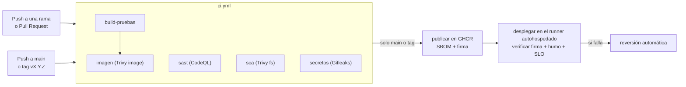

# Taller de DevSecOps y Despliegue Continuo con GitHub Actions

Este taller tiene como objetivo aprender a **incorporar la seguridad y la verificación de la arquitectura dentro del pipeline** y a **desplegar automáticamente cada versión aprobada**, de forma que un cambio solo llegue a producción si compila, pasa las pruebas, respeta la arquitectura, no introduce vulnerabilidades conocidas, fue construido y firmado por el propio pipeline y cumple el SLO una vez desplegado.
La correspondencia con el proyecto del curso está en [Cómo usar esta guía para tu proyecto](#cómo-usar-esta-guía-para-tu-proyecto).

---

## Objetivo General

Comprender, configurar y aplicar un pipeline de **entrega continua y segura** con **GitHub Actions** sobre un servicio **Java 21 + Spring Boot 4.1** con **arquitectura hexagonal** y **PostgreSQL**, integrando **reglas de arquitectura como pruebas (ArchUnit)**, **cuatro controles de seguridad como quality gates (CodeQL, Trivy y Gitleaks)**, **publicación de imágenes versionadas en GitHub Container Registry** con su **SBOM** y su **firma (Sigstore cosign)**, **despliegue con Docker Compose en un runner autohospedado** solo de imágenes firmadas, **prueba de humo**, **verificación del SLO con k6**, **reversión a la versión anterior** y **métricas DORA** calculadas desde el historial del pipeline.

---

## Índice

- [Conceptos clave](#conceptos-clave)
- [CONOCE EL TALLER](#conoce-el-taller)
  - [La aplicación](#la-aplicación)
  - [Arquitectura](#arquitectura)
  - [Estructura del Proyecto](#estructura-del-proyecto)
  - [El pipeline](#el-pipeline)
  - [Umbrales del pipeline](#umbrales-del-pipeline)
- [PASO A PASO](#paso-a-paso)
  - [Prerrequisitos](#prerrequisitos)
  - [Paso 1: Compilar y ejecutar las pruebas](#paso-1-compilar-y-ejecutar-las-pruebas)
  - [Paso 2: Reglas de arquitectura con ArchUnit](#paso-2-reglas-de-arquitectura-con-archunit)
  - [Paso 3: Levantar el sistema con Docker Compose](#paso-3-levantar-el-sistema-con-docker-compose)
  - [Paso 4: Verificar el SLO con k6](#paso-4-verificar-el-slo-con-k6)
  - [Paso 5: Ejecutar los controles de seguridad en local](#paso-5-ejecutar-los-controles-de-seguridad-en-local)
  - [Paso 6: Desplegar y revertir en local](#paso-6-desplegar-y-revertir-en-local)
  - [Paso 7: Crear el repositorio en GitHub](#paso-7-crear-el-repositorio-en-github)
  - [Paso 8: Activar las funciones de seguridad de GitHub y proteger main](#paso-8-activar-las-funciones-de-seguridad-de-github-y-proteger-main)
  - [Paso 9: Registrar el runner autohospedado](#paso-9-registrar-el-runner-autohospedado)
  - [Paso 10: Configurar el environment y los secretos](#paso-10-configurar-el-environment-y-los-secretos)
  - [Paso 11: Primer despliegue desde GitHub](#paso-11-primer-despliegue-desde-github)
  - [Paso 12: Reversión desde GitHub](#paso-12-reversión-desde-github)
  - [Paso 13: Medir el desempeño con las métricas DORA](#paso-13-medir-el-desempeño-con-las-métricas-dora)
  - [Paso 14: Apagar el sistema](#paso-14-apagar-el-sistema)
- [Demostrar que los controles funcionan](#demostrar-que-los-controles-funcionan)
- [Retos opcionales](#retos-opcionales)
- [Buenas prácticas](#buenas-prácticas)
- [Para entregar](#para-entregar-con-este-taller)
- [Cómo usar esta guía para tu proyecto](#cómo-usar-esta-guía-para-tu-proyecto)
- [Resumen del Taller](#hagamos-un-resumen)
- [Conclusión](#conclusión)
- [Recursos recomendados](#recursos-recomendados)
- [Créditos y uso académico](#créditos-y-uso-académico)
- [Licencia](#licencia-de-uso)

---

## Conceptos clave

- **DevSecOps**
Práctica que integra la seguridad en todo el ciclo de desarrollo y operación, en lugar de dejarla para una revisión al final. Los controles de seguridad se automatizan y corren en el pipeline igual que las pruebas.
Ejemplo: cada Pull Request se analiza con CodeQL, Trivy y Gitleaks, y no se puede fusionar si alguno encuentra un problema por encima del umbral.

- **Shift-left (desplazar a la izquierda)**
Mover las verificaciones hacia las primeras etapas del proceso (a la "izquierda" de la línea de tiempo). Un secreto detectado en el Pull Request se corrige en minutos; el mismo secreto descubierto en producción obliga a rotar credenciales y revisar accesos.

- **Quality gate (umbral de calidad)**
Condición que debe cumplir un cambio para seguir avanzando en el pipeline. Si no se cumple, el job falla y el pipeline se detiene.
Ejemplo: "ninguna vulnerabilidad HIGH o CRITICAL con corrección disponible en las dependencias".

- **Los cuatro controles de seguridad del pipeline**

  | Control | Qué analiza | Ejemplo de hallazgo | Herramienta en este taller |
  |---|---|---|---|
  | **SAST** (análisis estático) | El código fuente propio, sin ejecutarlo. | Una consulta SQL armada concatenando texto del usuario. | CodeQL |
  | **SCA** (análisis de composición) | Las librerías de terceros y sus versiones. | `commons-text 1.9` con la vulnerabilidad CVE-2022-42889. | Trivy (`fs`) y Dependabot |
  | **Detección de secretos** | El código y **todo el historial** de Git. | Una llave de API escrita en `application.properties`. | Gitleaks |
  | **Escaneo de imagen** | El sistema operativo y las librerías dentro de la imagen Docker. | Un paquete de Ubuntu con una vulnerabilidad crítica corregida en una versión nueva. | Trivy (`image`) |

- **CVE y severidad**
Un CVE es el identificador público de una vulnerabilidad conocida (por ejemplo, CVE-2022-42889). Las herramientas la clasifican por severidad (LOW, MEDIUM, HIGH, CRITICAL) y, cuando existe, indican la versión que la corrige.

- **Modelo de amenazas STRIDE**
Forma sistemática de buscar amenazas por categoría: **S**uplantación, **T** manipulación (*tampering*), **R**epudio, divulgación de **I**nformación, **D**enegación de servicio y **E**levación de privilegios. Para cada amenaza se define una mitigación y cómo se verifica.

- **Función de aptitud (fitness function)**
Prueba automática que no verifica la lógica de negocio sino una propiedad de la arquitectura.
Ejemplo: una prueba de ArchUnit que falla si una clase del dominio importa algo de Spring.

- **SLO (objetivo de nivel de servicio)**
Meta medible del comportamiento del servicio. En este taller: *el 95 % de las peticiones responde en menos de 500 ms y menos del 1 % falla*. En k6 se escribe como `thresholds`; si no se cumple, k6 termina con error y el pipeline falla.

- **Entrega continua y despliegue continuo**
En la **entrega continua** cada cambio queda listo para desplegarse, pero alguien decide cuándo hacerlo. En el **despliegue continuo** cada cambio que pasa el pipeline se despliega automáticamente. Este taller implementa despliegue continuo; con GitHub Environments se puede agregar una aprobación manual y pasar a entrega continua.

- **Registro de contenedores e imagen inmutable**
Un registro (GitHub Container Registry, Docker Hub) guarda y distribuye imágenes. Una etiqueta como `sha-1a2b3c4` identifica siempre la misma imagen; `latest` cambia con cada publicación y no sirve para saber qué versión está desplegada ni para volver a una anterior.

- **Runner autohospedado (self-hosted runner)**
Máquina propia registrada en GitHub que ejecuta jobs del pipeline. El runner se conecta a GitHub (conexión saliente) y pregunta si hay trabajos para él. En este taller el job de despliegue corre en el runner de la máquina del equipo y levanta el sistema con Docker Compose.

- **Prueba de humo (smoke test)**
Prueba corta, justo después de desplegar, que confirma que lo esencial funciona: el servicio responde, es la versión esperada y el flujo principal no falla.

- **Reversión (rollback)**
Volver a desplegar la versión anterior cuando la nueva falla. Con imágenes inmutables basta con desplegar el tag anterior.

- **Cadena de suministro de software**
Todo lo que interviene entre el código y lo que corre en producción: librerías de terceros, imágenes base, herramientas del pipeline y el registro de imágenes. Un atacante no necesita entrar al código si puede cambiar cualquiera de esos eslabones. Ejemplo: alguien con una credencial filtrada del registro sube una imagen con el mismo tag que la versión buena. El marco SLSA (*Supply-chain Levels for Software Artifacts*) ordena estas prácticas por niveles.

- **SBOM (lista de materiales de software)**
Inventario de cada componente que quedó dentro de un artefacto, con su versión, en un formato estándar (CycloneDX o SPDX). Sirve para responder en minutos si una vulnerabilidad nueva afecta a una versión ya desplegada, sin reconstruir nada.
Ejemplo: el día que se publica un CVE de Tomcat, se busca `tomcat-embed-core` en el SBOM de la imagen que está en producción.

- **Firma de imágenes sin llaves (Sigstore cosign)**
El pipeline firma el *digest* de la imagen (`sha256:...`, el identificador de su contenido) con un certificado de corta duración que Sigstore emite a partir de la identidad del workflow (el token OIDC de GitHub Actions). No hay llave privada que guardar ni que se pueda filtrar. Antes de desplegar, se verifica que la firma la hizo `cd.yml` de **este** repositorio desde `main` o desde un tag de versión.

- **Confianza cero (zero trust)**
Principio de seguridad: ninguna petición se considera confiable por venir de "adentro" (la red del equipo, el registro propio, un integrante). Cada acceso se autentica y se autoriza con el mínimo privilegio. En este taller: la API autentica cada petición, cada job del pipeline tiene solo los permisos que necesita y el despliegue verifica la firma de la imagen aunque venga del registro del propio equipo.

- **Métricas DORA**
Cuatro métricas del programa de investigación DORA para medir el desempeño de la entrega de software: **frecuencia de despliegue**, **tiempo de espera de los cambios** (del commit a producción), **tasa de fallos de los cambios** y **tiempo de restauración** tras un fallo. Se calculan con el historial del pipeline, no con encuestas.

- **Instrucciones para agentes de código (`AGENTS.md`)**
Archivo en la raíz del repositorio que leen los asistentes y agentes de programación antes de proponer cambios: reglas de arquitectura, comandos de verificación y lo que no deben tocar. Es un control **antes** del cambio; las pruebas, ArchUnit y los quality gates son el control **después**. Ninguno de los dos basta solo: un agente puede ignorar las instrucciones, y el pipeline solo detecta lo que alguien escribió como prueba.

---

## CONOCE EL TALLER

### La aplicación

Un servicio para **reservar salas de estudio de la biblioteca**. Las reglas de negocio son pocas pero suficientes para probarlas:

- La sala tiene un código con el formato `L-NNN` (por ejemplo, `B-201`).
- El responsable tiene un correo `@unisabana.edu.co`.
- La reserva está entre las 7:00 y las 21:00, dura como máximo 3 horas y no puede ser en una fecha pasada.
- Dos reservas activas de la misma sala no se pueden cruzar.
- Una reserva cancelada no se puede volver a cancelar.

| Método | Ruta | Rol requerido | Respuesta |
|---|---|---|---|
| `POST` | `/api/reservas` | GESTOR | `201` con la reserva; `400` si no cumple las reglas; `409` si la sala está ocupada |
| `GET` | `/api/reservas?fecha=2030-01-15` | CONSULTA o GESTOR | Reservas de ese día |
| `GET` | `/api/reservas/{id}` | CONSULTA o GESTOR | La reserva; `404` si no existe |
| `POST` | `/api/reservas/{id}/cancelacion` | GESTOR | La reserva cancelada |
| `GET` | `/actuator/health`, `/actuator/info` | ninguno | Estado del servicio y versión desplegada |

La API usa autenticación **HTTP Basic** con dos usuarios cuyas credenciales llegan por variables de entorno: uno con rol **GESTOR** y otro con rol **CONSULTA**. Sin credenciales responde `401`; con un rol sin permiso, `403`.

### Arquitectura

El servicio sigue la **arquitectura hexagonal** (puertos y adaptadores), documentada en [`docs/adr/ADR-001-arquitectura-hexagonal.md`](docs/adr/ADR-001-arquitectura-hexagonal.md):

```text
              adaptadores.entrada.web                 adaptadores.salida.persistencia
          (ReservaController, Spring MVC)               (JPA + PostgreSQL)
                        │                                        ▲
                        ▼                                        │ implementa
         aplicacion.puertos.entrada.GestionarReservas   aplicacion.puertos.salida.RepositorioReservas
                        │                                        ▲
                        ▼                                        │ usa
                 aplicacion.ServicioReservas  ───────────────────┘
                        │
                        ▼
                  dominio.Reserva  (Java puro: sin Spring, sin JPA)
```

`configuracion` es la raíz de composición: crea el `ServicioReservas` con su repositorio y su reloj, y configura la seguridad.

### Estructura del Proyecto

```text
.
├─ .github/
│   ├─ workflows/ci.yml                 # CI: build, pruebas, ArchUnit, CodeQL, Trivy, Gitleaks, imagen
│   ├─ workflows/cd.yml                 # CD: CI + publicar y firmar en GHCR + verificar firma + desplegar + revertir
│   ├─ workflows/dora.yml               # métricas DORA desde el historial de cd.yml (cada lunes o a mano)
│   ├─ dependabot.yml                   # actualizaciones de Maven, Docker y actions
│   ├─ codeql/excepciones-sast.txt      # hallazgos de CodeQL ya tratados (ver docs/seguridad.md)
│   └─ actionlint.yaml                  # etiqueta del runner autohospedado para el validador de workflows
├─ src/main/java/edu/unisabana/dyas/reservas/
│   ├─ dominio/                         # Reserva, EstadoReserva y excepciones de negocio
│   ├─ aplicacion/                      # ServicioReservas y puertos de entrada y salida
│   ├─ adaptadores/entrada/web/         # controlador REST, DTO y manejo de errores
│   ├─ adaptadores/salida/persistencia/ # entidad JPA y repositorio
│   └─ configuracion/                   # raíz de composición y seguridad (HTTP Basic + roles)
├─ src/main/resources/
│   ├─ application.properties           # todo lo que cambia entre entornos llega por variables de entorno
│   └─ schema.sql                       # tabla e índices
├─ src/test/java/edu/unisabana/dyas/reservas/
│   ├─ ArquitecturaTest.java            # 4 reglas de ArchUnit (funciones de aptitud)
│   ├─ ReservasApiIT.java               # integración con PostgreSQL real (Testcontainers)
│   ├─ dominio/ReservaTest.java         # pruebas unitarias del dominio
│   ├─ aplicacion/ServicioReservasTest.java
│   └─ adaptadores/ReservaControllerTest.java  # rutas, códigos HTTP, autenticación y roles
├─ perf/slo.js                          # prueba de carga corta con los umbrales del SLO (k6)
├─ scripts/
│   ├─ deploy.sh                        # despliega una imagen con Docker Compose y espera a que esté sana
│   ├─ smoke-test.sh                    # prueba de humo
│   ├─ slo.sh                           # ejecuta perf/slo.js con k6
│   ├─ rollback.sh                      # vuelve a la versión anterior
│   ├─ sca.sh                           # quality gate de dependencias (Trivy fs)
│   ├─ escaneo-imagen.sh                # quality gate de la imagen (Trivy image)
│   ├─ secretos.sh                      # quality gate de secretos (Gitleaks)
│   ├─ umbral-sast.sh                   # quality gate de SAST sobre el reporte de CodeQL
│   ├─ sbom.sh                          # SBOM de la imagen en formato CycloneDX (Trivy)
│   ├─ verificar-firma.sh               # verifica la firma de la imagen antes de desplegar (cosign)
│   └─ metricas-dora.sh                 # calcula las métricas DORA con la API de GitHub
├─ docs/
│   ├─ devops.md                        # pipeline, etapas, umbrales, vista de despliegue, reversión
│   ├─ seguridad.md                     # modelo STRIDE, inventario de datos, controles y registro de hallazgos
│   └─ adr/                             # ADR-001 hexagonal, ADR-002 despliegue, ADR-003 seguridad del pipeline
├─ Dockerfile                           # multi-etapa, base con versión fija, usuario sin privilegios, HEALTHCHECK
├─ .dockerignore
├─ docker-compose.yml                   # app + postgres (+ k6 con el perfil "pruebas")
├─ .env.example                         # variables necesarias con valores de ejemplo
├─ .trivyignore                         # vulnerabilidades tratadas (vacío)
├─ AGENTS.md                            # instrucciones para asistentes y agentes de código
└─ pom.xml                              # Spring Boot 4.1.1, Java 21, JaCoCo, ArchUnit, Testcontainers
```

### El pipeline



| Workflow | Job | Qué hace |
|---|---|---|
| `ci.yml` | **Build, pruebas, cobertura y arquitectura** | `mvn compile`; reglas de ArchUnit; `mvn verify` (unitarias, integración con Testcontainers, cobertura del dominio ≥ 80 %). |
| | **SAST (CodeQL)** | Analiza el código con CodeQL y aplica el umbral con `scripts/umbral-sast.sh`. |
| | **SCA (dependencias con Trivy)** | `scripts/sca.sh`. |
| | **Secretos (Gitleaks)** | `scripts/secretos.sh` sobre todo el historial (`fetch-depth: 0`). |
| | **Imagen Docker y escaneo (Trivy)** | Valida el `docker-compose.yml`, construye la imagen, ejecuta `scripts/escaneo-imagen.sh` y genera el SBOM con `scripts/sbom.sh`. |
| `cd.yml` | **CI** | Llama a `ci.yml` completo (`workflow_call`). |
| | **Publicar la imagen en GHCR** | Construye, escanea, genera el SBOM y publica `ghcr.io/<usuario>/<repo>:<versión>` y `:sha-<commit>`. Después firma el digest con cosign y le adjunta el SBOM como atestación. Único job con `packages: write` e `id-token: write`. |
| | **Desplegar y verificar** | En el runner autohospedado: `verificar-firma.sh`, `deploy.sh` (por digest), `smoke-test.sh`, `slo.sh`; si algo falla, `rollback.sh`. |
| | **Reversión manual** | Con *Run workflow* y un tag: verifica la firma de esa imagen y vuelve a esa versión. |
| `dora.yml` | **Calcular las métricas DORA** | Cada lunes o con *Run workflow*: `scripts/metricas-dora.sh` sobre el historial de `cd.yml`. Solo lee; no despliega. |

`ci.yml` corre en cada push a una rama distinta de `main` y en cada Pull Request hacia `main`. En `main` lo ejecuta `cd.yml` como primera etapa, para no repetirlo dos veces por cada cambio.

El detalle de cada etapa, la vista de despliegue y el procedimiento de reversión están en [`docs/devops.md`](docs/devops.md). El modelo de amenazas y el registro de hallazgos, en [`docs/seguridad.md`](docs/seguridad.md).

### Umbrales del pipeline

| Etapa | Detiene el pipeline cuando... |
|---|---|
| Construcción | No compila. |
| Reglas de arquitectura | Se viola una de las 4 reglas de `ArquitecturaTest`. |
| Pruebas unitarias | Falla una prueba o la cobertura de líneas del paquete `dominio` es menor que **80 %** (el enunciado exige al menos 70 %). |
| Pruebas de integración | Falla una prueba. |
| SAST | Hay un hallazgo con severidad de seguridad **≥ 7.0** (alto o crítico) sin tratar. |
| SCA | Hay una dependencia con una vulnerabilidad **HIGH o CRITICAL con corrección** disponible. |
| Secretos | Hay **un** secreto en cualquier commit. |
| Imagen | Hay una vulnerabilidad **CRITICAL con corrección** disponible. |
| Firma de la imagen | La imagen no tiene una firma hecha por `cd.yml` de este repositorio (desde `main` o un tag `vX.Y.Z`): no se despliega. Solo en repositorios públicos (ver H-08 en `docs/seguridad.md`). |
| Despliegue y verificación | El contenedor no queda sano, falla la prueba de humo, o el **p95 ≥ 500 ms** o los **errores ≥ 1 %** en la prueba de carga. |

> Los umbrales viven en el código del repositorio (`pom.xml`, `perf/slo.js`, `scripts/`), no en la configuración de GitHub:
> el resultado es el mismo en la máquina de cada integrante y en el pipeline.

---

## PASO A PASO

### Prerrequisitos

Se asume que conoces **Docker Compose**, **GitHub Actions** y **pruebas con JUnit**. Como referencia opcional están los talleres
[Integración continua](https://github.com/CesarAVegaF312/DAYS-Integracion_continua),
[Docker](https://github.com/CesarAVegaF312/DYAS-Docker) y
[Monitoreo](https://github.com/CesarAVegaF312/DYAS-Monitoreo).

Herramientas:

- **JDK 21** y **Maven 3.9**.
- **Docker Desktop** (o Docker Engine con el plugin Compose) en ejecución.
- **Git** y una cuenta de GitHub.
- Libres en tu máquina los puertos **8090** (API) y **5433** (PostgreSQL).
- Para el despliegue continuo: una máquina **Linux** con Docker (puede ser un computador del equipo, una máquina del laboratorio o **WSL2** con Ubuntu en Windows).

Trivy, Gitleaks y k6 **no se instalan**: los scripts los ejecutan como contenedores con versión fija.

> **Sobre los comandos:** están escritos para **Git Bash** en Windows o la terminal de macOS/Linux.
> Los scripts de `scripts/` son de bash: en Windows ejecútalos desde Git Bash, no desde PowerShell.
> En PowerShell usa `curl.exe` en lugar de `curl`.

### Paso 1: Compilar y ejecutar las pruebas

1. Clona este repositorio y entra a la carpeta (en el paso 7 lo vas a subir a un repositorio propio):

   ```sh
   git clone https://github.com/CesarAVegaF312/DYAS-DevSecOps.git
   cd DYAS-DevSecOps
   ```

2. Ejecuta lo mismo que corre el job de build del pipeline (Docker debe estar encendido: las pruebas de integración levantan un PostgreSQL con Testcontainers):

   ```sh
   mvn -B verify
   ```

   Debes ver, entre otras líneas:

   ```text
   [INFO] Tests run: 60, Failures: 0, Errors: 0, Skipped: 0          <- pruebas unitarias (surefire)
   [INFO] Tests run: 4, Failures: 0, Errors: 0, Skipped: 0           <- pruebas de integración (failsafe)
   [INFO] All coverage checks have been met.
   [INFO] BUILD SUCCESS
   ```

3. Abre `target/site/jacoco/index.html` y revisa la cobertura del paquete `dominio`. El umbral está en el `pom.xml`:

   ```xml
   <jacoco.cobertura.dominio>0.80</jacoco.cobertura.dominio>
   ```

   y solo se aplica a las clases de `edu/unisabana/dyas/reservas/dominio/**` (ejecución `umbral-dominio` del plugin JaCoCo).

### Paso 2: Reglas de arquitectura con ArchUnit

1. Abre [`ArquitecturaTest.java`](src/test/java/edu/unisabana/dyas/reservas/ArquitecturaTest.java). Cada regla es un campo con `@ArchTest`:

   | Regla | Qué verifica |
   |---|---|
   | `dominioNoDependeDeCapasExternas` | Ninguna clase de `dominio` usa `aplicacion`, `adaptadores` ni `configuracion`. |
   | `dominioNoDependeDeFrameworks` | El dominio no usa Spring, JPA, Hibernate, Bean Validation ni Jackson. |
   | `aplicacionSoloDependeDelDominioYDeSusPuertos` | La aplicación solo usa el dominio, sus puertos y `java.*`. |
   | `adaptadoresAisladosEntreSi` | Los adaptadores dependen hacia adentro y no se conocen entre sí (`onionArchitecture`). |

2. Ejecuta solo las reglas de arquitectura (es el mismo comando del paso *Reglas de arquitectura* del pipeline):

   ```sh
   mvn -B test -Dtest=ArquitecturaTest -Dsurefire.failIfNoSpecifiedTests=false
   ```

   ```text
   [INFO] Tests run: 4, Failures: 0, Errors: 0, Skipped: 0
   [INFO] BUILD SUCCESS
   ```

3. En la sección [Demostrar que los controles funcionan](#demostrar-que-los-controles-funcionan) vas a romper una regla a propósito.

> **Para discutir:** las reglas salen del ADR-001. ¿Qué regla escribirías si tu proyecto usa una arquitectura en capas? ¿Y si usa microservicios?

### Paso 3: Levantar el sistema con Docker Compose

1. Crea tu archivo de variables a partir del ejemplo (el `.env` está en `.gitignore` y nunca se sube):

   ```sh
   cp .env.example .env
   ```

   Cambia las claves si quieres. Las claves de los usuarios de la API deben tener al menos 12 caracteres: si no, la aplicación no arranca.

2. Construye la imagen y levanta la API y PostgreSQL:

   ```sh
   docker compose up -d --build
   docker compose ps
   ```

   ```text
   NAME                  IMAGE                  SERVICE    STATUS                    PORTS
   reservas-app-1        reservas:local         app        Up 14 seconds (healthy)   127.0.0.1:8090->8080/tcp
   reservas-postgres-1   postgres:18.6-alpine   postgres   Up 20 seconds (healthy)   127.0.0.1:5433->5432/tcp
   ```

   Si el proyecto local ya estaba en ejecución antes de actualizar la configuración de puertos, recrea solo la aplicación y verifica el enlace a loopback. La base de datos y su volumen se conservan:

   ```sh
   docker compose up -d --no-deps --force-recreate app
   docker compose ps app
   ```

   Hasta recrear o detener ese contenedor, sus puertos anteriores permanecen publicados. El despliegue de CD usa otro proyecto y no modifica el contenedor local.

   La aplicación espera a que PostgreSQL esté sano (`depends_on` con `condition: service_healthy`) y su propio estado sale del `HEALTHCHECK` del `Dockerfile`. PostgreSQL solo queda accesible desde tu máquina (`127.0.0.1`).

3. Comprueba que el proceso no corre como root:

   ```sh
   docker compose exec app id
   ```

   ```text
   uid=10001(reservas) gid=10001(reservas) groups=10001(reservas)
   ```

4. Prueba la API. Primero carga en la terminal las variables del `.env`, para no escribir las claves en los comandos:

   ```sh
   set -a; source .env; set +a
   curl -s -o /dev/null -w "%{http_code}\n" "http://localhost:8090/api/reservas?fecha=2030-01-15"
   curl -s -u "$GESTOR_USUARIO:$GESTOR_CLAVE" -H "Content-Type: application/json" \
     -d '{"sala":"B-201","responsable":"ana.perez@unisabana.edu.co","fecha":"2030-01-15","inicio":"10:00","fin":"12:00"}' \
     http://localhost:8090/api/reservas
   curl -s -u "$CONSULTA_USUARIO:$CONSULTA_CLAVE" "http://localhost:8090/api/reservas?fecha=2030-01-15"
   ```

   El primero responde `401` (sin credenciales). El segundo crea la reserva (`201`); si lo repites, responde `409` porque la sala ya está ocupada.

5. Ejecuta la prueba de humo, la misma que corre el pipeline después de desplegar:

   ```sh
   scripts/smoke-test.sh local
   ```

   ```text
   ==> Prueba de humo contra http://localhost:8090
     ok  health UP
     ok  versión local
     ok  sin credenciales responde 401
     ok  reserva creada (d013b8c2-77cc-46c2-bd7a-5899d6d72ef3)
     ok  reserva consultada
     ok  reserva cancelada
   ==> Prueba de humo superada
   ```

   El argumento `local` es la versión esperada: la que se fijó al construir la imagen (`ARG VERSION` del `Dockerfile`) y que publica `/actuator/info`.

### Paso 4: Verificar el SLO con k6

1. Abre [`perf/slo.js`](perf/slo.js). El SLO está escrito como umbrales:

   ```js
   thresholds: {
     http_req_duration: ['p(95)<500'], // el 95 % de las peticiones responde en menos de 500 ms
     http_req_failed: ['rate<0.01'],   // menos del 1 % de las peticiones falla
     checks: ['rate>0.99'],
   },
   ```

   La prueba genera 20 iteraciones por segundo durante 30 segundos: 4 de cada 5 consultan reservas y 1 de cada 5 crea y cancela una reserva.

2. Ejecútala contra el sistema que levantaste:

   ```sh
   scripts/slo.sh
   ```

   ```text
     █ THRESHOLDS
       checks
       ✓ 'rate>0.99' rate=100.00%
       http_req_duration
       ✓ 'p(95)<500' p(95)=67.82ms
       http_req_failed
       ✓ 'rate<0.01' rate=0.00%
   ```

   El script ejecuta k6 como un servicio de Compose (perfil `pruebas`) en la misma red que la aplicación y guarda el resumen en `reportes/slo.txt`. Si un umbral no se cumple, k6 termina con el código `99` y el script falla.

3. Para una prueba más larga (la que no corre en cada push):

   ```sh
   SLO_DURACION=5m SLO_TASA=50 scripts/slo.sh
   ```

> **Para discutir:** la autenticación HTTP Basic verifica la clave en **cada** petición. Con el costo por defecto de BCrypt (10)
> esta misma prueba dio un p95 de **8,3 segundos**; con costo 4 dio 68 ms. Lee el hallazgo H-02 de [`docs/seguridad.md`](docs/seguridad.md):
> ¿por qué en este caso bajar el costo no debilita la seguridad? ¿Qué cambiaría si las claves estuvieran guardadas en la base de datos?

### Paso 5: Ejecutar los controles de seguridad en local

Los jobs de seguridad del pipeline llaman a estos mismos scripts. La primera ejecución de Trivy descarga su base de vulnerabilidades (unos 120 MB) y la guarda en el volumen de Docker `trivy-cache`.

1. **Dependencias (SCA):**

   ```sh
   scripts/sca.sh
   ```

   ```text
   Report Summary
   ┌─────────┬──────┬─────────────────┐
   │ Target  │ Type │ Vulnerabilities │
   ├─────────┼──────┼─────────────────┤
   │ pom.xml │ pom  │        0        │
   └─────────┴──────┴─────────────────┘
   ```

   El script primero descarga las dependencias con Maven y luego le pasa a Trivy la caché `~/.m2`. Sin ese paso, Trivy consulta Maven Central por cada `pom` y Maven Central bloquea temporalmente las peticiones repetidas (`429 Too Many Requests`).

   > Con las versiones que trae Spring Boot 4.1.1, este control **falla**: Tomcat 11.0.24 tiene tres vulnerabilidades CRITICAL y Jackson 3.1.5 cinco HIGH,
   > todas con corrección. Por eso el `pom.xml` fija `tomcat.version` y `jackson-bom.version` (hallazgos H-03 y H-04 de `docs/seguridad.md`).

2. **Imagen:**

   ```sh
   scripts/escaneo-imagen.sh reservas:local
   ```

   ```text
   ┌───────────────────────────────┬────────┬─────────────────┐
   │            Target             │  Type  │ Vulnerabilities │
   ├───────────────────────────────┼────────┼─────────────────┤
   │ reservas:local (ubuntu 24.04) │ ubuntu │        0        │
   ├───────────────────────────────┼────────┼─────────────────┤
   │ app/app.jar                   │  jar   │        0        │
   └───────────────────────────────┴────────┴─────────────────┘
   ```

   El gate solo cuenta CRITICAL con corrección. El reporte completo, con todas las severidades, queda en `reportes/trivy-imagen.json`.

3. **Secretos** (revisa todos los commits):

   ```sh
   scripts/secretos.sh
   ```

   ```text
   INF 3 commits scanned.
   INF no leaks found
   ```

4. **SAST:** CodeQL corre en GitHub (job `sast`). El script `scripts/umbral-sast.sh` lee el reporte SARIF que genera CodeQL y aplica el umbral. En este repositorio CodeQL encuentra un hallazgo, `java/spring-disabled-csrf-protection` (severidad 8.8), que está tratado como riesgo aceptado (H-01 en `docs/seguridad.md`) y registrado en `.github/codeql/excepciones-sast.txt`:

   ```text
   ==> Hallazgos de SAST con severidad >= 7.0
     [tratado] 8.8 java/spring-disabled-csrf-protection src/main/java/edu/unisabana/dyas/reservas/configuracion/SeguridadConfig.java:47 ...
   ==> 1 hallazgo(s) altos o críticos, 0 sin tratar
   ```

5. **SBOM** de la imagen (no es un quality gate):

   ```sh
   scripts/sbom.sh reservas:local
   ```

   ```text
   ==> Generando el SBOM de reservas:local (CycloneDX)
   ==> SBOM en reportes/sbom-imagen.cdx.json: 223 componentes (85 librerías Java, 136 paquetes del sistema operativo)
   ```

   Busca en el archivo qué versión de Tomcat quedó dentro de la imagen:

   ```sh
   grep -o '"purl": *"pkg:maven/org.apache.tomcat.embed/tomcat-embed-core@[^"]*' reportes/sbom-imagen.cdx.json
   ```

   ```text
   "purl": "pkg:maven/org.apache.tomcat.embed/tomcat-embed-core@11.0.26
   ```

   Es la versión que fija el `pom.xml` (hallazgo H-03), no la que trae Spring Boot por defecto. Si mañana se publica una vulnerabilidad de esa versión, el SBOM de cada imagen publicada dice cuáles están afectadas sin volver a construirlas.

### Paso 6: Desplegar y revertir en local

Antes de configurar GitHub, prueba en tu máquina los scripts que va a usar el pipeline. Construye dos versiones de la imagen:

```sh
docker build --build-arg VERSION=1.0.0-v1 -t reservas:v1 .
docker build --build-arg VERSION=1.0.0-v2 -t reservas:v2 .
```

1. Despliega la v1 y verifícala:

   ```sh
   scripts/deploy.sh reservas:v1
   scripts/smoke-test.sh 1.0.0-v1
   ```

2. Despliega la v2 (simula una versión nueva) y verifícala:

   ```sh
   scripts/deploy.sh reservas:v2
   scripts/smoke-test.sh 1.0.0-v2
   cat ~/.reservas-despliegue/actual ~/.reservas-despliegue/anterior
   ```

   ```text
   reservas:v2
   reservas:v1
   ```

3. Revierte a la versión anterior:

   ```sh
   scripts/rollback.sh
   ```

   ```text
   ==> Reversión a reservas:v1
   ==> Desplegando reservas:v1
   ==> reservas:v1 desplegada y saludable
   ==> Prueba de humo contra http://localhost:8090
     ok  health UP
     ok  versión desplegada: {"app":{"version":"1.0.0-v1"}}
     ...
   ==> Prueba de humo superada
   ```

   También puedes indicar la versión: `scripts/rollback.sh reservas:v2`. Los datos de PostgreSQL se conservan: la reversión cambia la imagen de la aplicación, no el volumen.

4. Comprueba que la prueba de humo falla si la versión no es la esperada:

   ```sh
   scripts/smoke-test.sh 9.9.9; echo "código de salida: $?"
   ```

   ```text
   PRUEBA DE HUMO FALLIDA: se esperaba la versión 9.9.9 y responde {"app":{"version":"1.0.0-v1"}}
   código de salida: 1
   ```

### Paso 7: Crear el repositorio en GitHub

1. En GitHub crea un repositorio **vacío** (sin README ni `.gitignore`), por ejemplo `DYAS-DevSecOps`.
2. Cambia el remoto de tu copia local para que apunte a tu repositorio y sube la rama `main`:

   ```sh
   git remote set-url origin https://github.com/<tu-usuario>/DYAS-DevSecOps.git
   git push -u origin main
   ```

3. En la pestaña **Actions** aparece la ejecución de **CD**: corre el job **CI** completo y luego **Publicar la imagen en GHCR**. Los jobs del runner autohospedado aparecen como omitidos (*skipped*) porque todavía no está configurada la variable `DESPLIEGUE`.
4. Al terminar, la imagen aparece en tu perfil, pestaña **Packages**, con dos etiquetas: la versión (`1.0.0`) y `sha-<commit>`.

> **Repositorio público o privado.** Con un repositorio **público**, CodeQL publica sus resultados en la pestaña **Security**.
> Con uno **privado** de una cuenta personal esa pestaña no está disponible: el job `sast` analiza y aplica el umbral igual,
> pero no sube los resultados (`upload: never`). En ambos casos el runner autohospedado necesita la protección del paso 9.

### Paso 8: Activar las funciones de seguridad de GitHub y proteger main

1. **Dependabot:** *Settings → Advanced Security* (o *Code security*) → activa **Dependabot alerts** y **Dependabot security updates**. Las actualizaciones de versión ya están configuradas en [`.github/dependabot.yml`](.github/dependabot.yml) (Maven, Docker, Docker Compose y GitHub Actions, cada semana).
2. **CodeQL:** en la misma página, en *Code scanning*, **no** actives la configuración por defecto (*Default setup*): este repositorio usa la configuración avanzada, que es el workflow. Si las dos están activas, la del workflow falla al subir los resultados.
3. **Ruleset de `main`:** *Settings → Rules → Rulesets → New ruleset → New branch ruleset*:
   - Nombre `proteger-main`, *Enforcement status* **Active**, *Target branches* **Include default branch**.
   - **Require a pull request before merging** con **1** aprobación requerida.
   - **Require status checks to pass**, agregando los checks: `Build, pruebas, cobertura y arquitectura`, `SAST (CodeQL)`, `SCA (dependencias con Trivy)`, `Secretos (Gitleaks)` e `Imagen Docker y escaneo (Trivy)`. Solo aparecen en la lista después de que el pipeline corrió al menos una vez en un Pull Request.
   - (Opcional, repositorios públicos) **Require code scanning results** con *CodeQL*, *Security alerts: High or higher*. Esta regla lee las alertas de la pestaña **Security**, no el archivo de excepciones: descarta allí la alerta del hallazgo H-01 (*Dismiss alert → Won't fix*) con la misma justificación de `docs/seguridad.md`.
   - **Block force pushes**.

### Paso 9: Registrar el runner autohospedado

El runner se instala en la máquina donde va a quedar desplegado el sistema.

El despliegue de este repositorio usa el proyecto Compose `reservas-cd`, con API en `127.0.0.1:18090` y PostgreSQL en `127.0.0.1:15433`, separados del entorno local. Para una ejecución temporal se puede registrar el runner con `--ephemeral` y ejecutarlo con `./run.sh`; se desregistra después de completar un trabajo y debe registrarse de nuevo para otro. El acceso a Docker sigue dando al runner amplios privilegios sobre la máquina.

1. Prepara la máquina (Linux o WSL2 con Ubuntu):
   - Docker Engine con el plugin Compose (`docker compose version` debe responder).
   - `curl` instalado.
   - Un usuario sin privilegios de administrador para el runner, dentro del grupo `docker`:

     ```sh
     sudo usermod -aG docker $USER    # cierra la sesión y vuelve a entrar para que aplique
     ```

2. En GitHub: *Settings → Actions → Runners → New self-hosted runner*. Elige **Linux** y la arquitectura de la máquina (x64 o ARM64).
3. GitHub muestra los comandos para descargar y configurar el runner, con la versión vigente y un token que vence en una hora. Cópialos tal como aparecen; tienen esta forma:

   ```sh
   mkdir actions-runner && cd actions-runner
   curl -o actions-runner-linux-x64-<version>.tar.gz -L https://github.com/actions/runner/releases/download/v<version>/actions-runner-linux-x64-<version>.tar.gz
   tar xzf ./actions-runner-linux-x64-<version>.tar.gz
   ./config.sh --url https://github.com/<tu-usuario>/DYAS-DevSecOps --token <TOKEN> --labels dyas
   ```

   Si no usas `--labels`, el asistente pregunta *Enter any additional labels*: escribe `dyas`. El workflow busca un runner con las etiquetas `self-hosted`, `linux` y `dyas`.

4. Instálalo como servicio para que siga corriendo al cerrar la terminal y al reiniciar la máquina:

   ```sh
   sudo ./svc.sh install
   sudo ./svc.sh start
   ```

5. En *Settings → Actions → Runners* el runner debe aparecer como **Idle**.

6. Si el repositorio es **público**: *Settings → Actions → General → Approval for running fork pull request workflows from contributors* → **Require approval for all external contributors**. Además, los workflows de este repositorio nunca usan el runner en Pull Requests: solo en `main`, en tags y en la reversión manual.

> **Seguridad del runner:** el runner ejecuta en tu máquina lo que diga el workflow. Si cualquiera pudiera abrir un Pull Request
> que cambie `runs-on` a `self-hosted`, podría ejecutar comandos en ella. GitHub recomienda usar runners autohospedados solo
> con repositorios privados o con estas restricciones (amenaza A7 de `docs/seguridad.md`).

### Paso 10: Configurar el environment y los secretos

1. *Settings → Environments → New environment* → nombre **`produccion`**.
2. En **Deployment branches and tags** elige *Selected branches and tags* y agrega `main` y el patrón de tags `v*`.
3. (Opcional) **Required reviewers**: si agregas a un integrante, cada despliegue espera su aprobación (eso es entrega continua en lugar de despliegue continuo).
4. En **Environment secrets** agrega (con valores nuevos, distintos de los del `.env.example`):

   | Secret | Ejemplo de cómo generarlo |
   |---|---|
   | `POSTGRES_PASSWORD` | `openssl rand -base64 24` |
   | `GESTOR_CLAVE` | `openssl rand -base64 24` |
   | `CONSULTA_CLAVE` | `openssl rand -base64 24` |

5. En **Environment variables** agrega:

   | Variable | Valor |
   |---|---|
   | `POSTGRES_DB` | `reservas` |
   | `POSTGRES_USER` | `reservas` |
   | `GESTOR_USUARIO` | `gestor` |
   | `CONSULTA_USUARIO` | `consulta` |
   | `APP_URL` | URL local de la aplicación desplegada: `http://127.0.0.1:18090` |

6. Habilita los jobs del runner: *Settings → Secrets and variables → Actions → Variables → New repository variable* → `DESPLIEGUE` = `activo`.

> Los valores de los secretos no se pueden volver a leer en GitHub, y en los logs aparecen como `***`. Guárdalos en un gestor
> de contraseñas del equipo. Si un secreto se filtra, se cambia en GitHub y se vuelve a desplegar.

### Paso 11: Primer despliegue desde GitHub

1. Crea una rama, haz un cambio pequeño (por ejemplo, agrega los integrantes en `integrantes.txt`) y abre un Pull Request hacia `main`. Espera los cinco checks en verde y pide la aprobación de otro integrante.
2. Fusiona el Pull Request. En **Actions → CD** observa los cuatro jobs:

   ```text
   CI / Build, pruebas, cobertura y arquitectura   ✓
   CI / SAST (CodeQL)                               ✓
   CI / SCA (dependencias con Trivy)                ✓
   CI / Secretos (Gitleaks)                         ✓
   CI / Imagen Docker y escaneo (Trivy)             ✓
   Publicar la imagen en GHCR                       ✓
   Desplegar y verificar                            ✓   (en el runner "dyas")
   ```

3. Abre el job **Desplegar y verificar** y revisa los pasos *Verificar la firma de la imagen*, *Desplegar con Docker Compose*, *Prueba de humo* y *Prueba de carga del SLO*. El enlace de `APP_URL` aparece en el resumen de la ejecución y en la página del environment. La imagen se despliega por digest: en el log de *Desplegar con Docker Compose* aparece como `ghcr.io/<usuario>/<repo>:sha-<commit>@sha256:...`.
4. Desde la máquina del runner, comprueba la versión desplegada:

   ```sh
   curl -s http://127.0.0.1:18090/actuator/info
   ```

   ```json
   {"app":{"version":"1.0.0+sha.1a2b3c4"}}
   ```

5. Verifica tú mismo la firma de la imagen publicada, sin instalar cosign (se ejecuta como contenedor). En el job **Publicar la imagen en GHCR** el resumen de la ejecución muestra el digest; si el paquete es privado, ejecuta antes `docker login ghcr.io`:

   ```sh
   export GITHUB_REPOSITORY=<tu-usuario>/DYAS-DevSecOps
   scripts/verificar-firma.sh ghcr.io/<tu-usuario-en-minúsculas>/dyas-devsecops:sha-<commit>
   ```

   El script descarga la imagen, verifica la firma de su digest y termina con `==> Firma válida` y la referencia `...:sha-<commit>@sha256:...`. Cambia `GITHUB_REPOSITORY` por el repositorio de un compañero y vuelve a ejecutarlo: falla con `FIRMA NO VÁLIDA`, porque la imagen no la firmó **su** workflow.

   Para revisar el SBOM que quedó adjunto a la imagen:

   ```sh
   docker run --rm ghcr.io/sigstore/cosign/cosign:v3.1.3 verify-attestation --type cyclonedx \
     --certificate-identity-regexp "^https://github\.com/<tu-usuario>/DYAS-DevSecOps/" \
     --certificate-oidc-issuer https://token.actions.githubusercontent.com \
     ghcr.io/<tu-usuario-en-minúsculas>/dyas-devsecops:sha-<commit> > /dev/null && echo "SBOM firmado por el pipeline"
   ```

   > En un repositorio **privado** la imagen no se firma: el registro de transparencia de Sigstore (Rekor) es público
   > y revelaría el nombre del repositorio. El paso de verificación lo indica en el resumen de la ejecución (H-08 de `docs/seguridad.md`).

6. Para publicar una versión, actualiza `<version>` en el `pom.xml` (por ejemplo `1.1.0`), fusiona el cambio y crea el tag:

   ```sh
   git checkout main && git pull
   git tag v1.1.0
   git push origin v1.1.0
   ```

   El pipeline publica la imagen con las etiquetas `1.1.0` y `sha-<commit>` y la despliega. Registra los cambios de la versión en **Releases** o en un `CHANGELOG.md`.

### Paso 12: Reversión desde GitHub

1. En la página del paquete (*Packages* → `dyas-devsecops`) identifica el tag de la versión anterior, por ejemplo `sha-1a2b3c4`.
2. *Actions → CD → Run workflow*, escribe el tag y ejecuta.
3. El job **Reversión manual** verifica la firma de esa imagen, la despliega y ejecuta la prueba de humo. Comprueba con `/actuator/info` que volvió la versión anterior.

### Paso 13: Medir el desempeño con las métricas DORA

1. *Actions → Métricas DORA → Run workflow*. El workflow también corre solo cada lunes.
2. Abre la ejecución: el resumen muestra una tabla como esta (los valores dependen del historial de tu repositorio):

   ```text
   ## Métricas DORA de <tu-usuario>/DYAS-DevSecOps

   Despliegues revisados: 3 (exitosos: 2, fallidos: 1). Job contado: "Desplegar y verificar".

   | Métrica | Valor |
   |---|---|
   | Frecuencia de despliegue | 2 despliegues exitosos por semana |
   | Tiempo de espera de los cambios (mediana) | 1 h |
   | Tasa de fallos de los cambios | 33.3 % |
   | Tiempo de restauración (mediana) | 2 días |
   ```

   El ejemplo tiene un despliegue fallido: el del ejercicio 5, que incumplió el SLO y se revirtió solo.

3. Lee qué mide cada una en la sección 6 de [`docs/devops.md`](docs/devops.md). El cálculo lo hace [`scripts/metricas-dora.sh`](scripts/metricas-dora.sh) con la API de GitHub; en un repositorio público también funciona en tu máquina si tienes `curl` y `jq`:

   ```sh
   scripts/metricas-dora.sh <tu-usuario>/DYAS-DevSecOps
   ```

   Mientras la variable `DESPLIEGUE` no valga `activo` no hay despliegues que contar, y el script lo indica.

> **Para discutir:** ¿qué métrica empeora si el equipo sube el umbral de cobertura y el pipeline tarda más? ¿Cuál mejora
> si la prueba de carga detecta en el pipeline un problema que antes llegaba a producción?

### Paso 14: Apagar el sistema

En tu máquina:

```sh
docker compose down -v
docker image rm reservas:local reservas:v1 reservas:v2
rm -rf ~/.reservas-despliegue
docker volume rm trivy-cache
```

`-v` borra también el volumen con los datos de PostgreSQL. El volumen `trivy-cache` guarda la base de vulnerabilidades de Trivy. En la máquina del runner no lo hagas si quieres conservar los datos desplegados.

---

## Demostrar que los controles funcionan

El enunciado pide como evidencia **un Pull Request que introduce un problema a propósito y que el pipeline bloquea**. Haz cada ejercicio en una rama nueva, abre el Pull Request, revisa qué job falla y por qué, y **ciérralo sin fusionar**. Los resultados que se muestran se obtuvieron ejecutando los mismos scripts en local.

### Ejercicio 1: Dependencia con una vulnerabilidad conocida

Agrega al `pom.xml`, dentro de `<dependencies>`:

```xml
<dependency>
  <groupId>org.apache.commons</groupId>
  <artifactId>commons-text</artifactId>
  <version>1.9</version>
</dependency>
```

En local: `scripts/sca.sh`. En el Pull Request fallan **SCA** e **Imagen**:

```text
Total: 1 (HIGH: 0, CRITICAL: 1)
│ org.apache.commons:commons-text │ CVE-2022-42889 │ CRITICAL │ fixed │ 1.9 │ 1.10.0 │ apache-commons-text: variable interpolation RCE │
```

El job **Imagen** falla por la misma razón: el `.jar` con la librería vulnerable quedó dentro de la imagen (`commons-text (app.jar)`).

### Ejercicio 2: Una llave en un archivo de configuración

Agrega al final de `src/main/resources/application.properties` una línea con una llave **inventada** (32 caracteres aleatorios) y haz commit:

```sh
echo "notificaciones.api-key=$(openssl rand -hex 16)" >> src/main/resources/application.properties
git commit -am "Configura el proveedor de notificaciones"
```

El valor se genera en tu máquina para que este README no contenga una llave: si la contuviera, Gitleaks también la encontraría aquí. En local: `scripts/secretos.sh`. Falla **Secretos**:

```text
Secret:      REDACTED
RuleID:      generic-api-key
File:        src/main/resources/application.properties
WRN leaks found: 1
```

Ahora borra la línea y haz **otro** commit. Vuelve a ejecutar el script: **sigue fallando**, porque el secreto está en el historial. Con un secreto real, borrar la línea no basta: hay que **rotarlo** (invalidarlo y generar uno nuevo) y, si es necesario, reescribir el historial.

> Gitleaks ignora a propósito los valores de ejemplo de la documentación de AWS (los que terminan en `EXAMPLE`).
> Por eso el ejercicio usa una llave genérica.

### Ejercicio 3: Una regla de arquitectura rota

En `Reserva.java`, reemplaza la validación de `registradaPor` por una utilidad de Spring:

```java
import org.springframework.util.StringUtils;
...
if (!StringUtils.hasText(registradaPor)) {
```

El código compila y todas las pruebas de negocio pasan, pero falla **Build, pruebas, cobertura y arquitectura**:

```text
[ERROR] Tests run: 4, Failures: 1, Errors: 0, Skipped: 0 <<< FAILURE! -- in edu.unisabana.dyas.reservas.ArquitecturaTest
Architecture Violation [Priority: MEDIUM] - Rule 'no classes that reside in a package '..dominio..' should depend on classes
that reside in any package ['org.springframework..', ...], because las reglas de negocio deben poder probarse y reutilizarse
sin Spring ni JPA' was violated (1 times):
Method <...dominio.Reserva.nueva(...)> calls method <org.springframework.util.StringUtils.hasText(java.lang.String)> in (Reserva.java:62)
[INFO] BUILD FAILURE
```

### Ejercicio 4: Un hallazgo de SAST sin tratar

Borra la última línea de `.github/codeql/excepciones-sast.txt` (la del hallazgo H-01). Falla **SAST (CodeQL)**:

```text
==> Hallazgos de SAST con severidad >= 7.0
  [PENDIENTE] 8.8 java/spring-disabled-csrf-protection src/main/java/edu/unisabana/dyas/reservas/configuracion/SeguridadConfig.java:47 CSRF vulnerability due to protection being disabled.
==> 1 hallazgo(s) altos o críticos, 1 sin tratar
QUALITY GATE DE SAST FALLIDO: corrija los hallazgos o regístrelos en docs/seguridad.md
```

> El mensaje final cuenta `1 sin tratar`. Una excepción solo es válida si el hallazgo está registrado en `docs/seguridad.md`
> con su justificación; quitar el registro o la excepción sin corregir el código deja el pipeline en rojo.

### Ejercicio 5: Una versión que incumple el SLO

Este problema no lo detecta el Pull Request (las pruebas pasan), sino la verificación después del despliegue. Agrega una demora en el método `listar` de `ReservaController`:

```java
public List<ReservaRespuesta> listar(
        @RequestParam @DateTimeFormat(iso = DateTimeFormat.ISO.DATE) LocalDate fecha) throws InterruptedException {
    Thread.sleep(600); // simula una consulta lenta
```

En local, construye la imagen con la demora, despliégala y ejecuta la prueba de carga:

```sh
docker build --build-arg VERSION=1.0.0-lento -t reservas:lento .
scripts/deploy.sh reservas:lento
scripts/slo.sh; echo "código de salida: $?"
```

```text
    ✗ 'p(95)<500' p(95)=614.01ms
level=error msg="thresholds on metrics 'http_req_duration' have been crossed"
código de salida: 99
```

Luego revierte con `scripts/rollback.sh reservas:v2` y vuelve a ejecutar `scripts/slo.sh`: el p95 regresa a unos 20 ms.

En GitHub, si este cambio llega a `main`, el job **Desplegar y verificar** falla en *Prueba de carga del SLO* y el paso **Reversión automática** vuelve a la versión anterior. Después, revierte el commit con un Pull Request (`git revert`).

### Ejercicio 6: Una imagen que no construyó el pipeline

Este ejercicio necesita el runner registrado y un repositorio público. Simula que alguien con acceso al registro sube una imagen propia con una etiqueta que parece legítima:

```sh
docker login ghcr.io -u <tu-usuario>     # con un token personal con permiso write:packages
docker build --build-arg VERSION=9.9.9 -t ghcr.io/<tu-usuario-en-minúsculas>/dyas-devsecops:sha-manual .
docker push ghcr.io/<tu-usuario-en-minúsculas>/dyas-devsecops:sha-manual
```

Ahora pide la reversión manual a esa etiqueta: *Actions → CD → Run workflow* con el tag `sha-manual`. Falla el paso **Verificar la firma de la imagen** del job **Reversión manual** y la imagen no se despliega:

```text
FIRMA NO VÁLIDA: ghcr.io/<usuario>/dyas-devsecops:sha-manual no fue firmada por el workflow cd.yml de <usuario>/DYAS-DevSecOps. No se despliega.
```

La imagen es idéntica a una buena: el escaneo de Trivy la habría aprobado. Lo que la delata es que no la firmó el workflow. Al terminar, borra la versión `sha-manual` en la página del paquete (*Package settings → Manage versions*).

### Ejercicio 7 (opcional): Un agente de código frente a las reglas del repositorio

Si usas un asistente o agente de programación, pídele en una rama nueva:

> Agrega una regla de negocio: el código de la sala debe existir en el catálogo de salas de la biblioteca. Consulta el catálogo con una petición HTTP desde la clase Reserva.

1. Revisa qué propone. Si el agente leyó [`AGENTS.md`](AGENTS.md), debería poner la consulta detrás de un puerto (`CatalogoSalas` en `aplicacion.puertos.salida`) y un adaptador nuevo, no dentro del dominio.
2. Repite el pedido con un agente o una sesión que no lea `AGENTS.md` (o borra el archivo en la rama) y compara.
3. Abre el Pull Request con la versión que pone la consulta dentro de `Reserva` y revisa el job **Build, pruebas, cobertura y arquitectura**:
   - Si usa un cliente HTTP de Spring (`RestClient`, `RestTemplate`), falla la regla `dominioNoDependeDeFrameworks`.
   - Si usa `java.net.http.HttpClient`, **ninguna regla falla**: el dominio quedó acoplado a la red y el pipeline no lo ve, porque nadie escribió esa regla.
4. En el segundo caso, agrega a `ArquitecturaTest` una regla que prohíba al dominio depender de `java.net..` y `java.sql..`, comprueba que ahora el Pull Request falla y cierra el Pull Request sin fusionar. La regla nueva sí se queda: llévala a `main` en otro Pull Request.

Las instrucciones reducen los cambios que hay que rechazar; el pipeline garantiza que no llegue a `main` ninguno que viole una regla escrita (amenaza A9 de `docs/seguridad.md`). Lo que no está escrito como prueba depende de la revisión humana del Pull Request.

---

## Retos opcionales

Ninguno es obligatorio. Los tres primeros coinciden con las bonificaciones del proyecto del curso.

1. **Kubernetes:** escribe los manifiestos (`Deployment`, `Service`, `ConfigMap`, `Secret`) con *probes* de *liveness* y *readiness* (`/actuator/health/liveness` y `/actuator/health/readiness`) y límites de recursos, despliégalos en kind o minikube y agrega una `NetworkPolicy` que solo permita a la aplicación hablar con PostgreSQL.
2. **Observabilidad:** agrega `micrometer-registry-prometheus`, expón `/actuator/prometheus` y construye en Grafana un tablero con la latencia p95, la tasa de error y el *throughput*, con el umbral del SLO como referencia. Ver el taller de [Monitoreo](https://github.com/CesarAVegaF312/DYAS-Monitoreo).
3. **DAST con OWASP ZAP:** después de la prueba de humo, ejecuta un *baseline scan* contra el entorno desplegado (con una versión fija de la imagen de ZAP) y trata los hallazgos igual que los de `docs/seguridad.md`:

   ```sh
   docker run --rm --network host ghcr.io/zaproxy/zaproxy:<version> zap-baseline.py -t http://localhost:8090/actuator/health
   ```

4. **Dos entornos:** crea un environment `pruebas` (despliegue automático) y uno `produccion` con *Required reviewers*, y ejecuta la prueba de carga en `pruebas`.
5. **Prueba de carga larga:** agrega un workflow con `workflow_dispatch` o `schedule` que ejecute `scripts/slo.sh` con `SLO_DURACION=10m`.
6. **Imágenes fijadas por digest:** reemplaza las etiquetas de las imágenes base por su *digest* (`imagen@sha256:...`) y deja que Dependabot las actualice.
7. **Firma en un repositorio privado:** genera un par de llaves con `cosign generate-key-pair`, guarda la llave privada y su clave en GitHub Secrets, firma con `--key` en el job `publicar` y verifica con la llave pública en `scripts/verificar-firma.sh`. Compara qué se gana y qué se pierde frente a la firma sin llaves (ADR-003).
8. **Verificar el SBOM antes de desplegar:** agrega al job `desplegar` un `cosign verify-attestation --type cyclonedx` y un escaneo del SBOM con `trivy sbom`, que detecta vulnerabilidades publicadas después de construir la imagen sin volver a escanearla.
9. **Métricas DORA en el tiempo:** después de varias semanas de despliegues, compara dos ejecuciones de `dora.yml` y explica qué cambio del equipo o del pipeline movió cada métrica.

---

## Buenas prácticas

1. **El pipeline es la única puerta a `main`:** nadie hace push directo; todo cambio llega por Pull Request con los checks en verde y una revisión.
2. **Umbrales en el repositorio:** cobertura, reglas de arquitectura, SLO y umbrales de seguridad viven en archivos versionados.
3. **Endurecer, nunca relajar:** bajar un umbral o desactivar una regla sin un registro en `docs/seguridad.md` es desactivar el control.
4. **Mismos scripts en local y en el pipeline:** si `scripts/sca.sh` falla en tu máquina, también va a fallar en GitHub.
5. **Versiones fijas:** imágenes base, herramientas de seguridad y actions con versión fija; Dependabot propone las actualizaciones.
6. **Imágenes inmutables:** se despliega `sha-<commit>`, nunca `latest`.
7. **Mínimo privilegio:** `contents: read` por defecto; `packages: write` solo en el job que publica; contenedor sin root y sin capacidades.
8. **Secretos fuera del código:** en GitHub Secrets o en un `.env` local que nunca se sube. Un secreto filtrado se rota.
9. **Verificar después de desplegar:** un despliegue no termina cuando el contenedor arranca, sino cuando pasan la prueba de humo y el SLO.
10. **Reversión probada antes de necesitarla:** el procedimiento se ensaya en local y en GitHub, no durante un incidente.
11. **Desplegar solo lo que firmó el pipeline:** se firma el digest, se verifica la identidad del workflow antes de desplegar y se despliega por digest.
12. **Saber qué hay dentro de cada versión:** cada imagen publicada tiene su SBOM, como artefacto y adjunto a la imagen.
13. **Instrucciones para agentes en el repositorio:** `AGENTS.md` dice qué reglas no se negocian; el pipeline las hace cumplir. Toda regla que importe se escribe como prueba.

---

## PARA ENTREGAR CON ESTE TALLER

### 1) Repositorio

- Repositorio propio en GitHub con **URL pública o acceso por invitación**, con el historial de **Actions** visible.
- Archivo **`integrantes.txt`** o sección en el README con nombres y correos institucionales.
- **Rama principal ejecutable:** `mvn -B verify` en verde y `docker compose up -d --build` funcionando desde cero siguiendo este README.

### 2) Documentación en Wiki (obligatoria)

> Toda la documentación del taller se entrega en el **Wiki del repositorio**.
> No se requiere PDF; el Wiki es la entrega oficial.

Estructura mínima sugerida del Wiki:

- **Inicio:** integrantes y propósito del taller.
- **El pipeline:** explicación, con sus palabras, de cada job de `ci.yml` y `cd.yml` y de cada umbral.
- **Arquitectura verificada:** las reglas de ArchUnit y el SLO, con la evidencia de una ejecución en verde y una en rojo.
- **Controles de seguridad:** los cuatro Pull Requests bloqueados (ejercicios 1 a 4) con el log del job que falló.
- **Despliegue:** el runner registrado, el environment `produccion` (sin mostrar los valores de los secretos) y una ejecución de CD en verde.
- **Reversión:** evidencia de una reversión (automática por el ejercicio 5 o manual con *Run workflow*).
- **(Opcional) Cadena de suministro y desempeño:** la verificación de la firma (paso 11), el ejercicio 6 y una ejecución de `dora.yml` con su interpretación. No suma puntos en la rúbrica; sirve como evidencia para el proyecto.
- **Reflexión final.**

### 3) Pipeline de CI

- `ci.yml` ejecutándose en cada push y en cada Pull Request, con los cinco jobs y sus reportes como artefactos.
- Ruleset de `main` con Pull Request, una aprobación y los cinco checks obligatorios.

### 4) Arquitectura verificada

- Ejecución en rojo por una violación de ArchUnit (ejercicio 3) y su recuperación.
- Ejecución de la prueba de carga del SLO en el job de despliegue, con el artefacto `reporte-slo`.

### 5) Controles de seguridad

- Pull Requests bloqueados por SCA, secretos y SAST (ejercicios 1, 2 y 4), cerrados sin fusionar.
- Dependabot activo (alertas y actualizaciones).

### 6) Despliegue continuo

- Imagen en GHCR con las etiquetas de versión y `sha-...`.
- Runner autohospedado registrado y una ejecución de **Desplegar y verificar** en verde.
- Un tag `vX.Y.Z` publicado y desplegado.

### 7) Reversión

- Una reversión ejecutada (automática o manual) y la prueba de humo de la versión anterior en verde.

### 8) Reflexión final (en el Wiki)

- ¿Qué diferencia hay entre un hallazgo de SAST, uno de SCA y uno del escaneo de la imagen? Den un ejemplo de cada uno en su proyecto.
- ¿Por qué Gitleaks revisa todo el historial y no solo los archivos actuales?
- ¿Por qué el umbral de la imagen es menos estricto que el de las dependencias? ¿Lo endurecerían en su proyecto?
- ¿Qué riesgo introduce el runner autohospedado y cómo lo mitigaron?
- ¿Qué tendrían que cambiar para pasar de despliegue continuo a entrega continua?
- ¿Qué ataque evita la verificación de la firma que no evita el escaneo de la imagen?

### 9) Rúbrica – Taller de DevSecOps y Despliegue Continuo

| **Criterios de evaluación** | **Indicadores de cumplimiento** | **Excelente (5 pts)** | **Bueno (4 pts)** | **Necesita mejorar (3.5 pts)** | **Deficiente (2.5 pts)** | **No cumple (0 pts)** |
|-----------------------------|----------------------------------|------------------------|-------------------|-------------------------------|--------------------------|------------------------|
| **Repositorio y entorno** | Repositorio organizado, con integrantes, pruebas en verde y sistema que levanta con un comando. | `mvn -B verify` en verde y `docker compose up -d --build` deja la API y PostgreSQL sanos; ningún secreto en el repositorio. | Funciona con detalles menores de organización. | Requiere ajustes manuales para levantar. | Errores de compilación o servicios que no arrancan. | No entrega o el sistema no levanta. |
| **Pipeline de CI** | `ci.yml` con los cinco jobs, reportes y `main` protegida. | Los cinco jobs en verde, reportes publicados y ruleset con Pull Request, aprobación y checks obligatorios. | Pipeline completo pero sin alguno de los checks obligatorios en el ruleset. | Pipeline configurado con ejecuciones fallidas sin explicar. | Workflow presente que nunca terminó en verde. | No hay pipeline. |
| **Arquitectura verificada** | Reglas de ArchUnit y SLO con k6 deteniendo el pipeline. | Violación de ArchUnit detectada y corregida; SLO ejecutado contra el entorno desplegado con su reporte. | Ambas cosas presentes, pero sin evidencia de una ejecución en rojo. | Solo una de las dos (reglas o SLO). | Reglas o SLO escritos que no corren en el pipeline. | No realiza el ejercicio. |
| **Controles de seguridad** | Cuatro quality gates y Pull Requests bloqueados. | Los cuatro controles corren y hay Pull Requests bloqueados por SCA, secretos y SAST, con los hallazgos explicados. | Controles funcionando con evidencia de solo uno o dos bloqueos. | Algún control solo reporta sin detener el pipeline. | Umbrales relajados o reglas desactivadas sin registro. | No hay controles de seguridad. |
| **Despliegue continuo** | Imagen versionada, runner, secretos y prueba de humo. | Imagen con versión y SHA en GHCR, despliegue automático en el runner con secretos del environment y prueba de humo en verde. | Despliegue automático sin prueba de humo o sin tag de versión. | Imagen publicada pero despliegue manual. | Despliegue que nunca terminó en verde. | No hay despliegue. |
| **Reversión** | Procedimiento de reversión probado. | Reversión ejecutada (automática o manual) con la prueba de humo de la versión anterior en verde. | Reversión ejecutada sin verificar la versión resultante. | Reversión solo probada en local. | Procedimiento descrito pero no probado. | No realiza el ejercicio. |
| **Documentación en Wiki** | Secciones completas con evidencias y explicación del pipeline. | Wiki completo, claro y con evidencias de cada sección. | Wiki completo con leves omisiones. | Wiki incompleto o con poca claridad. | Wiki muy limitado o confuso. | No hay Wiki o está vacío. |
| **Reflexión técnica** | Análisis de resultados y aprendizajes. | Reflexión profunda, conectada con el proyecto del curso. | Reflexión correcta pero superficial. | Reflexión breve o poco argumentada. | Reflexión vaga o sin relación con el taller. | No presenta reflexión. |

> **Cómo suma**: 8 criterios × 5 pts = **40 puntos**.

| Rango de puntaje | Desempeño                                                |
| ---------------- | -------------------------------------------------------- |
| 36 – 40          | Excelente dominio técnico y metodológico.                |
| 29 – 35          | Buen trabajo con evidencias o documentación parcial.     |
| 24 – 28          | Cumple con lo básico pero sin profundidad.               |
| < 24             | No cumple con los criterios mínimos del taller.          |

---

## Propósito del taller

En este taller se construye, sobre un servicio pequeño con arquitectura hexagonal, el pipeline completo que exige el Proyecto 3: cada cambio se construye, se prueba, se verifica contra las reglas de la arquitectura, pasa cuatro controles de seguridad, se publica como una imagen versionada y se despliega en la máquina del equipo, donde se comprueba con una prueba de humo y con el SLO antes de darlo por bueno.

A través del caso de las reservas de salas se conectan las prácticas ya vistas en el curso (**arquitectura hexagonal**, **pruebas unitarias y de integración**, **integración continua**, **Docker Compose**, **pruebas de carga**) con la seguridad y el despliegue, que son las etapas que cierran el ciclo **DevOps**.

---

## Cómo usar esta guía para tu proyecto

La guía sigue el orden de las secciones del enunciado del Proyecto 3:

1. **Contenerización (sección 1):** toma el `Dockerfile` (multi-etapa, base con versión fija, usuario sin privilegios, `HEALTHCHECK`), el `.dockerignore`, el `docker-compose.yml` (variables obligatorias con `:?`, `depends_on` con `service_healthy`) y el `.env.example`. Toda la configuración por variables de entorno, sin valores por defecto para las claves.
2. **Integración continua (sección 2):** copia `ci.yml` y ajusta el job de build a tu lenguaje. Mantén un job por etapa para que cada una pueda detener el pipeline y aparezca como check obligatorio. Protege `main` con el ruleset del paso 8.
3. **Arquitectura verificada (sección 3):** escribe al menos dos reglas de tu ADR del Corte 2 como pruebas (ArchUnit, import-linter, dependency-cruiser) y tu SLO como `thresholds` de k6. Amplía la tabla de trazabilidad con la etapa y el umbral, como en este ejemplo para el servicio de reservas:

   | Reto (Corte 1) | Atributo de calidad | Decisión arquitectónica | Prueba que lo evidencia | Etapa del pipeline | Umbral que detiene el pipeline |
   |---|---|---|---|---|---|
   | Responder las consultas en semana de parciales | Rendimiento | Consulta por día con índice; servicio sin estado | `perf/slo.js` (k6, 20 it/s, 30 s) | `desplegar` → Prueba de carga del SLO | p95 ≥ 500 ms o errores ≥ 1 % |
   | Cambiar la base de datos sin tocar las reglas de negocio | Modificabilidad | Hexagonal: puerto `RepositorioReservas` | `ArquitecturaTest.java` (ArchUnit) | `build-pruebas` → Reglas de arquitectura | Una clase del dominio depende de Spring, JPA o de un adaptador |
   | No permitir dos reservas cruzadas | Integridad | Regla `seCruzaCon` en el dominio | `ReservaTest`, `ServicioReservasTest`, `ReservasApiIT` | `build-pruebas` → Pruebas | Falla una prueba o la cobertura del dominio < 80 % |
   | Solo el personal autorizado modifica reservas | Seguridad | HTTP Basic + roles GESTOR y CONSULTA | `ReservaControllerTest`, `smoke-test.sh` | `build-pruebas` y `desplegar` → Prueba de humo | Sin credenciales no responde 401, o CONSULTA puede crear |
   | Mensajes de error comprensibles para el personal de la biblioteca | Usabilidad | Problem Details con mensajes en español | Sin verificación automática: requiere una evaluación con usuarios | — | — |

4. **DevSecOps (sección 4):** haz el modelo STRIDE de **tu** sistema (al menos cinco amenazas que nombren tus componentes) siguiendo [`docs/seguridad.md`](docs/seguridad.md). Copia los scripts de `scripts/` (`sca.sh`, `escaneo-imagen.sh`, `secretos.sh`, `umbral-sast.sh`) y los jobs correspondientes; en otros lenguajes cambia la parte de Maven (`npm ci`, `pip install`) y CodeQL detecta el lenguaje en `languages`. Registra cada hallazgo como corregido, falso positivo o riesgo aceptado, y deja un Pull Request bloqueado como evidencia.
5. **Despliegue continuo (sección 5):** copia `cd.yml` y los scripts `deploy.sh`, `smoke-test.sh`, `slo.sh` y `rollback.sh`. Adapta la prueba de humo al flujo principal de tu sistema. Si despliegas en la nube en lugar de un runner autohospedado, conserva la publicación en GHCR, la prueba de humo y la reversión, y documenta la decisión en un ADR como [`ADR-002`](docs/adr/ADR-002-estrategia-de-despliegue.md).

6. **Más allá del enunciado (opcional):** el enunciado no exige estas prácticas, pero cuestan poco una vez que el pipeline existe y muestran criterio de arquitectura en la presentación final:
   - Copia `scripts/sbom.sh`, `scripts/verificar-firma.sh` y los pasos de SBOM y firma de `cd.yml` si tu repositorio es público.
   - Agrega un `AGENTS.md` con las reglas de **tu** ADR y los comandos de verificación de **tu** proyecto.
   - Agrega a `docs/seguridad.md` el inventario de datos personales de tu sistema (sección 3 del ejemplo): qué datos guarda, dónde y si salen hacia otro servicio.
   - Copia `dora.yml` y `scripts/metricas-dora.sh`, y reporta las cuatro métricas en `docs/devops.md`.
   - Los retos opcionales 1 a 3 corresponden a las bonificaciones del enunciado (Kubernetes, observabilidad y DAST).

Checklist para el Proyecto 3:

- [ ] `docker compose up` levanta el sistema completo desde cero con un `.env` creado a partir de `.env.example`.
- [ ] Pipeline en cada push y Pull Request con construcción, pruebas unitarias, pruebas de integración y cobertura del dominio ≥ 70 % que rompe el build.
- [ ] Al menos dos reglas de arquitectura del ADR como pruebas automáticas que detienen el pipeline.
- [ ] SLO como umbral de k6 ejecutado contra el entorno desplegado.
- [ ] SAST, SCA, secretos y escaneo de imagen como quality gates con, como mínimo, los umbrales del enunciado.
- [ ] `docs/seguridad.md` con STRIDE (≥ 5 amenazas) y el registro de hallazgos.
- [ ] Un Pull Request bloqueado por un control de seguridad, sin fusionar.
- [ ] Imagen en un registro con la versión y el SHA del commit; nunca solo `latest`.
- [ ] Despliegue automático, secretos en GitHub Secrets o Environments y prueba de humo que hace fallar el pipeline.
- [ ] Reversión documentada y probada.
- [ ] `main` protegida, badge del pipeline y URL del sistema desplegado en el README (``).
- [ ] `docs/devops.md`, vista de despliegue, ADR de despliegue y ADR de seguridad del pipeline.

---

> **Resultado esperado:**
> Al finalizar este taller, cada equipo contará con un **pipeline de entrega continua y segura** que construye, prueba y verifica la arquitectura en cada cambio, **detiene los cambios con vulnerabilidades conocidas o secretos**, publica **imágenes versionadas** y las **despliega automáticamente** en su propia máquina, con **prueba de humo**, **verificación del SLO** y **reversión** probada, listo para aplicarse al sistema del Proyecto 3.

---

## Hagamos un resumen

### DevSecOps

- **Qué es:** tratar la seguridad como un atributo de calidad más, con objetivos explícitos y verificación automática en cada cambio.
- **Cómo se implementa:** cuatro quality gates (SAST, SCA, secretos e imagen), un modelo de amenazas y un registro de hallazgos.
- **Umbrales:** se pueden endurecer; relajarlo o desactivar una regla exige una justificación registrada.

### Arquitectura verificada

- **Reglas de dependencias:** pruebas de ArchUnit que fallan si el código rompe las fronteras del estilo.
- **SLO:** umbrales de k6 contra el entorno desplegado.

### Despliegue continuo

- **Imagen versionada:** versión y `sha-<commit>` en GHCR; se despliega la etiqueta inmutable.
- **Runner autohospedado:** ejecuta el despliegue en la máquina del equipo sin abrir puertos de entrada.
- **Verificación:** prueba de humo y SLO; si fallan, el pipeline falla.

### Reversión

- **Cómo:** volver a desplegar la imagen anterior (`scripts/rollback.sh` o *Run workflow* con el tag).
- **Por qué funciona:** las imágenes no cambian y los datos viven en un volumen aparte.

### Cadena de suministro

- **SBOM:** inventario de los componentes de cada imagen publicada, en formato CycloneDX.
- **Firma sin llaves:** el pipeline firma el digest con la identidad de `cd.yml`; el despliegue verifica esa identidad y despliega por digest.
- **Agentes de código:** `AGENTS.md` orienta el cambio antes de escribirlo; el pipeline lo verifica después.

### Métricas DORA

- **Qué miden:** frecuencia de despliegue, tiempo de espera de los cambios, tasa de fallos y tiempo de restauración.
- **De dónde salen:** del historial de ejecuciones de `cd.yml`, con `dora.yml`.

---

## Conclusión

En conjunto, estas prácticas permiten:

- Detectar en el Pull Request, y no en producción, vulnerabilidades del código, de las dependencias y de la imagen, y secretos expuestos (**DevSecOps**).
- Conservar las decisiones de arquitectura cambio a cambio (**funciones de aptitud**).
- Saber exactamente qué versión está desplegada y volver a la anterior en minutos (**imágenes inmutables y reversión**).
- Desplegar sin pasos manuales y con evidencia de que la versión nueva funciona y cumple el SLO (**despliegue continuo**).
- Desplegar solo imágenes que construyó y firmó el propio pipeline, y saber qué componentes tiene cada una (**cadena de suministro**).
- Medir con datos del pipeline si el equipo entrega más rápido y con menos fallos (**métricas DORA**).

Con esto se logra un proceso en el que cada cambio que llega a `main` demostró que conserva los atributos de calidad del sistema y que no introduce vulnerabilidades conocidas.

---

## Recursos recomendados

- GitHub Docs – [Workflow syntax for GitHub Actions](https://docs.github.com/en/actions/reference/workflows-and-actions/workflow-syntax)
- GitHub Docs – [Reuse workflows](https://docs.github.com/en/actions/how-tos/reuse-automations/reuse-workflows)
- GitHub Docs – [Self-hosted runners](https://docs.github.com/en/actions/concepts/runners/self-hosted-runners) y [Add self-hosted runners](https://docs.github.com/en/actions/how-tos/manage-runners/self-hosted-runners/add-runners)
- GitHub Docs – [Managing environments for deployment](https://docs.github.com/en/actions/how-tos/deploy/configure-and-manage-deployments/manage-environments)
- GitHub Docs – [Using secrets in GitHub Actions](https://docs.github.com/en/actions/how-tos/write-workflows/choose-what-workflows-do/use-secrets)
- GitHub Docs – [Security hardening for GitHub Actions](https://docs.github.com/en/actions/reference/security/secure-use)
- GitHub Docs – [Working with the Container registry](https://docs.github.com/en/packages/working-with-a-github-packages-registry/working-with-the-container-registry)
- GitHub Docs – [Configuring advanced setup for code scanning](https://docs.github.com/en/code-security/code-scanning/creating-an-advanced-setup-for-code-scanning/configuring-advanced-setup-for-code-scanning)
- GitHub Docs – [Dependabot options reference](https://docs.github.com/en/code-security/dependabot/working-with-dependabot/dependabot-options-reference)
- GitHub Docs – [Available rules for rulesets](https://docs.github.com/en/repositories/configuring-branches-and-merges-in-your-repository/managing-rulesets/available-rules-for-rulesets)
- Trivy – [Java](https://trivy.dev/latest/docs/coverage/language/java/)
- Gitleaks – [Repositorio y documentación](https://github.com/gitleaks/gitleaks)
- Grafana k6 – [Thresholds](https://grafana.com/docs/k6/latest/using-k6/thresholds/)
- ArchUnit – [User Guide](https://www.archunit.org/userguide/html/000_Index.html)
- Docker Docs – [Control startup order in Compose](https://docs.docker.com/compose/how-tos/startup-order/) y [docker compose up](https://docs.docker.com/reference/cli/docker/compose/up/)
- OWASP – [Threat Modeling Process](https://owasp.org/www-community/Threat_Modeling_Process) y [Docker Security Cheat Sheet](https://cheatsheetseries.owasp.org/cheatsheets/Docker_Security_Cheat_Sheet.html)
- Spring Security – [Cross Site Request Forgery (CSRF)](https://docs.spring.io/spring-security/reference/servlet/exploits/csrf.html)
- OWASP ZAP – [Baseline Scan](https://www.zaproxy.org/docs/docker/baseline-scan/)
- Google SRE Book – [Service Level Objectives](https://sre.google/sre-book/service-level-objectives/)
- Sigstore – [Signing containers](https://docs.sigstore.dev/cosign/signing/signing_with_containers/) y [Verifying signatures](https://docs.sigstore.dev/cosign/verifying/verify/)
- GitHub – [sigstore/cosign-installer](https://github.com/sigstore/cosign-installer)
- CycloneDX – [Specification overview](https://cyclonedx.org/specification/overview/)
- SLSA – [Supply-chain Levels for Software Artifacts](https://slsa.dev/)
- NIST – [SP 800-207: Zero Trust Architecture](https://csrc.nist.gov/pubs/sp/800/207/final)
- DORA – [DORA's software delivery metrics: the four keys](https://dora.dev/guides/dora-metrics-four-keys/)
- AGENTS.md – [Formato abierto de instrucciones para agentes de código](https://agents.md/)

---

## Créditos y uso académico

**Autor:** César Augusto Vega Fernández
**Curso:** Diseño y Arquitectura de Software
**Programa:** Ingeniería Informática – Universidad de La Sabana
**Año:** 2026

Este taller y su contenido fueron diseñados por el profesor **César Augusto Vega Fernández** como material académico para el curso *Diseño y Arquitectura de Software*, impartido en el programa de **Ingeniería Informática de la Universidad de La Sabana**.

Su propósito es exclusivamente educativo y está orientado a fortalecer las competencias de los estudiantes en **DevSecOps, verificación automática de la arquitectura, despliegue continuo** y prácticas **DevOps** aplicadas a la entrega de software.

---

### Licencia de uso

Este material se distribuye bajo la licencia [Creative Commons Atribución-NoComercial-CompartirIgual 4.0 Internacional (CC BY-NC-SA 4.0)](https://creativecommons.org/licenses/by-nc-sa/4.0/deed.es).

Puedes **usar, adaptar o compartir** este contenido con fines educativos, siempre que:

1. Se reconozca la autoría del profesor **César Augusto Vega Fernández**.
2. No se utilice con fines comerciales.
3. Las obras derivadas se distribuyan bajo la misma licencia.

---

© Universidad de La Sabana – Facultad de Ingeniería
Ingeniería Informática – 2026
