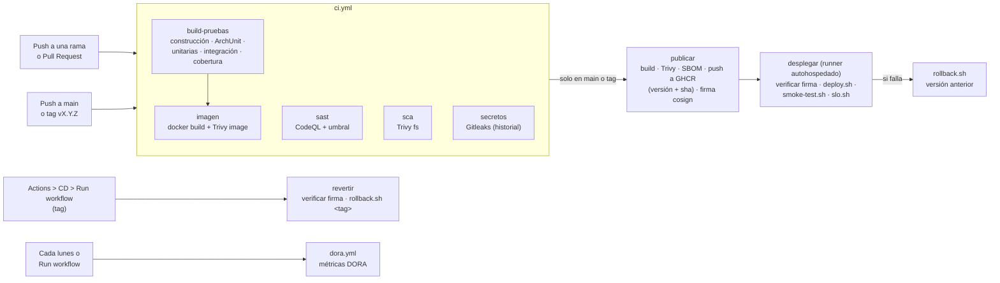
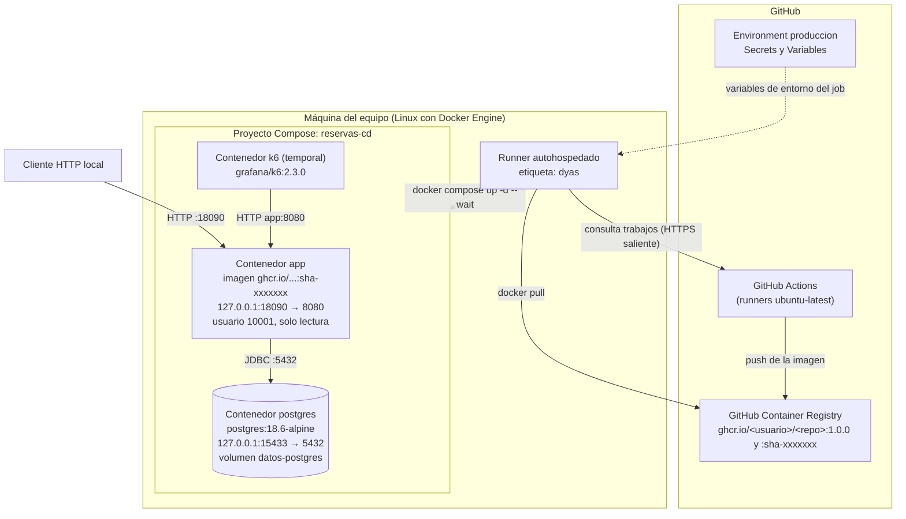

# Pipeline de entrega continua y segura

Este documento describe el pipeline del servicio de reservas: qué etapas tiene, qué verifica cada una, qué umbral la detiene y por qué se eligió ese valor. También muestra la vista de despliegue y el procedimiento de reversión.

## 1. Diagrama del pipeline

- En un Pull Request corre solo `ci.yml`. Sus jobs son los *checks* obligatorios del ruleset de `main`.
- En `main` (o al crear un tag `vX.Y.Z`) corre `cd.yml`, que primero ejecuta `ci.yml` completo (`workflow_call`) y solo si todo pasa publica y despliega.
- Los jobs `desplegar` y `revertir` solo corren si la variable del repositorio `DESPLIEGUE` vale `activo`.

## 2. Etapas y umbrales

| Etapa (enunciado) | Job / paso | Herramienta | Detiene el pipeline cuando... | Por qué ese valor |
|---|---|---|---|---|
| Construcción | `build-pruebas` / *Construcción* | Maven (`mvn compile`) | No compila o no se resuelven las dependencias. | Sin código que compile no tiene sentido seguir. |
| Reglas de arquitectura | `build-pruebas` / *Reglas de arquitectura* | ArchUnit (`ArquitecturaTest`) | Se viola una de las cuatro reglas de dependencias de ADR-001. | Las reglas protegen las fronteras de la arquitectura hexagonal; una sola violación ya acopla el dominio a la infraestructura. |
| Pruebas unitarias | `build-pruebas` / *Pruebas...* | JUnit 5 + Mockito (surefire) | Falla una prueba o la cobertura de líneas del paquete `dominio` baja de **80 %**. | El enunciado exige al menos 70 %. Se usa 80 % porque el dominio es pequeño y concentra las reglas de negocio. |
| Pruebas de integración | `build-pruebas` / *Pruebas...* | Testcontainers con PostgreSQL 18.6 (failsafe) | Falla una prueba. | Verifica la frontera con la base de datos real, con la misma versión que el despliegue. |
| Análisis de seguridad: código | `sast` | CodeQL + `scripts/umbral-sast.sh` | Hay un hallazgo con severidad ≥ 7.0 sin tratar. | Umbral mínimo del enunciado (alto o crítico). |
| Análisis de seguridad: dependencias | `sca` | Trivy `fs` | Hay una vulnerabilidad HIGH o CRITICAL con corrección disponible. | Umbral mínimo del enunciado. Si hay corrección, actualizar es responsabilidad del equipo. |
| Análisis de seguridad: secretos | `secretos` | Gitleaks | Aparece un secreto en cualquier commit. | Umbral mínimo del enunciado: cero secretos, incluido el historial. |
| Imagen y escaneo | `imagen` y `publicar` | Docker + Trivy `image` | Hay una vulnerabilidad CRITICAL con corrección disponible. | Umbral mínimo del enunciado. El sistema base tiene vulnerabilidades sin corrección que no dependen del equipo (H-05). |
| SBOM (no lo exige el enunciado) | `imagen` y `publicar` / *SBOM de la imagen* | Trivy (CycloneDX) | No detiene el pipeline. | Deja registro de cada componente de la imagen publicada, para revisar después si una vulnerabilidad nueva afecta a una versión ya desplegada. |
| Firma de la imagen (no lo exige el enunciado) | `publicar` / *Firmar la imagen...*; `desplegar` y `revertir` / *Verificar la firma de la imagen* | cosign (Sigstore) + `scripts/verificar-firma.sh` | La imagen no tiene una firma de `cd.yml` de este repositorio desde `main` o desde un tag. | Garantiza que lo que se despliega lo construyó y lo escaneó este pipeline, no alguien con acceso al registro (amenaza A3). |
| Despliegue | `desplegar` / *Desplegar con Docker Compose* | `scripts/deploy.sh` | El contenedor no llega a *healthy* en 180 s. | Tiempo holgado para que arranque la JVM y se conecte a PostgreSQL. |
| Verificación: prueba de humo | `desplegar` / *Prueba de humo* | `scripts/smoke-test.sh` | Health no está UP, la versión no es la desplegada, la API no exige autenticación o falla el flujo crear, consultar y cancelar. | Comprueba lo mínimo para decir que la versión nueva funciona. |
| Verificación: SLO | `desplegar` / *Prueba de carga del SLO* | k6 (`perf/slo.js`) | p95 ≥ **500 ms** o errores ≥ **1 %** con 20 iteraciones por segundo durante 30 s. | Es el SLO del servicio: una consulta de reservas debe sentirse inmediata. La prueba es corta para no alargar el pipeline; la prueba larga se lanza a mano. |

Todos los reportes (pruebas, cobertura, CodeQL, Trivy, SBOM, Gitleaks y k6) se publican como artefactos de cada ejecución. Las dependencias de Maven quedan en caché (`setup-java` con `cache: maven`), de modo que el pipeline de integración tarde menos de 10 minutos.

## 3. Vista de despliegue

El runner solo abre conexiones salientes hacia GitHub: no hace falta abrir puertos de la máquina a Internet para desplegar.
El proyecto Compose de CD es independiente del entorno local `reservas`: usa su propio volumen y publica ambos servicios en loopback. Un runner con acceso a Docker tiene privilegios amplios sobre la máquina; estas medidas no aíslan los trabajos del sistema anfitrión.
La decisión y sus consecuencias están registradas en [ADR-004](adr/ADR-004-aislamiento-despliegue.md).

## 4. Configuración del despliegue

| Nombre | Tipo (environment `produccion`) | Uso |
|---|---|---|
| `POSTGRES_PASSWORD` | Secret | Clave de PostgreSQL |
| `GESTOR_CLAVE` | Secret | Clave del usuario con rol GESTOR |
| `CONSULTA_CLAVE` | Secret | Clave del usuario con rol CONSULTA |
| `POSTGRES_DB`, `POSTGRES_USER` | Variable | Nombre de la base de datos y su usuario |
| `GESTOR_USUARIO`, `CONSULTA_USUARIO` | Variable | Nombres de los usuarios de la API |
| `APP_URL` | Variable | URL del sistema desplegado (aparece en la ejecución del pipeline) |
| `DESPLIEGUE` | Variable **del repositorio** | `activo` para habilitar los jobs del runner autohospedado |

`GITHUB_TOKEN` lo crea GitHub en cada ejecución. Solo el job `publicar` tiene permiso `packages: write` e `id-token: write` (el segundo, para pedir el certificado de firma); `desplegar` y `revertir` tienen `packages: read`; el resto solo `contents: read`.

## 5. Reversión

El script `scripts/deploy.sh` guarda en `~/.reservas-despliegue/` qué imagen estaba desplegada antes de cada despliegue. En los jobs de CD, `DEPLOY_STATE_DIR` usa el directorio `.reservas-despliegue-cd` dentro del espacio de trabajo del runner, fuera del código descargado, para conservar un historial separado.

| Situación | Qué pasa |
|---|---|
| Falla el despliegue, la prueba de humo o el SLO | El paso *Reversión automática* ejecuta `scripts/rollback.sh`, que vuelve a la imagen anterior y repite la prueba de humo. El pipeline queda en rojo. |
| Se detecta un problema después | Actions → CD → *Run workflow* con el tag de la imagen (por ejemplo `sha-1a2b3c4` o `1.0.0`). El job `revertir` la despliega y ejecuta la prueba de humo. |
| Sin GitHub (en la máquina) | `scripts/rollback.sh ghcr.io/<usuario>/<repo>:<tag>` con las variables del `.env`. |

Antes de desplegar, el job guarda la referencia activa y la usa si necesita revertir, incluso si falla la descarga de la nueva imagen. Los pasos de despliegue, humo y carga tienen límites individuales para que un fallo por tiempo permita iniciar la reversión. La cancelación completa del job o la caída de la máquina pueden impedir que se ejecute; en ese caso hay que comprobar el estado y revertir manualmente.
El primer despliegue del entorno de CD no tiene una versión anterior registrada. Si falla, el workflow detiene la aplicación no verificada. El proyecto local anterior mantiene sus propios datos y estado; no se migran automáticamente.

Los tags anteriores se consultan en la página del paquete en GitHub (*Packages*) o en el resumen de cada ejecución del job `publicar`.

La reversión cambia la imagen, no los datos: el esquema de la base de datos debe ser compatible con la versión anterior (en este servicio, `schema.sql` solo crea tablas e índices si no existen).

## 6. Métricas DORA

El workflow `dora.yml` calcula cada lunes (o a mano, con *Run workflow*) las cuatro métricas de desempeño de entrega del programa DORA a partir del historial de `cd.yml`. Lo hace `scripts/metricas-dora.sh`, que solo lee la API de GitHub.

| Métrica | Qué mide en este repositorio | Qué dice del pipeline |
|---|---|---|
| Frecuencia de despliegue | Ejecuciones exitosas del job *Desplegar y verificar* por semana. | Qué tan seguido llega un cambio a producción. |
| Tiempo de espera de los cambios | Mediana del tiempo entre el último commit de cada push y el fin de su despliegue verificado. | Cuánto tarda un cambio aprobado en estar disponible. Incluye el pipeline completo y la espera del runner. |
| Tasa de fallos de los cambios | Despliegues fallidos (despliegue, prueba de humo o SLO) sobre el total. | Cuántos cambios pasan la CI pero fallan en producción. |
| Tiempo de restauración | Mediana del tiempo entre un despliegue fallido y el siguiente exitoso. | Qué tan rápido el equipo vuelve a tener una versión sana desplegada. La reversión automática cuenta como fallo; el arreglo posterior cierra el intervalo. |

Las métricas se leen como tendencia del equipo, no como meta individual: con pocas ejecuciones, un solo despliegue cambia mucho los valores. El resultado queda en el resumen de la ejecución y en el artefacto `metricas-dora`.
